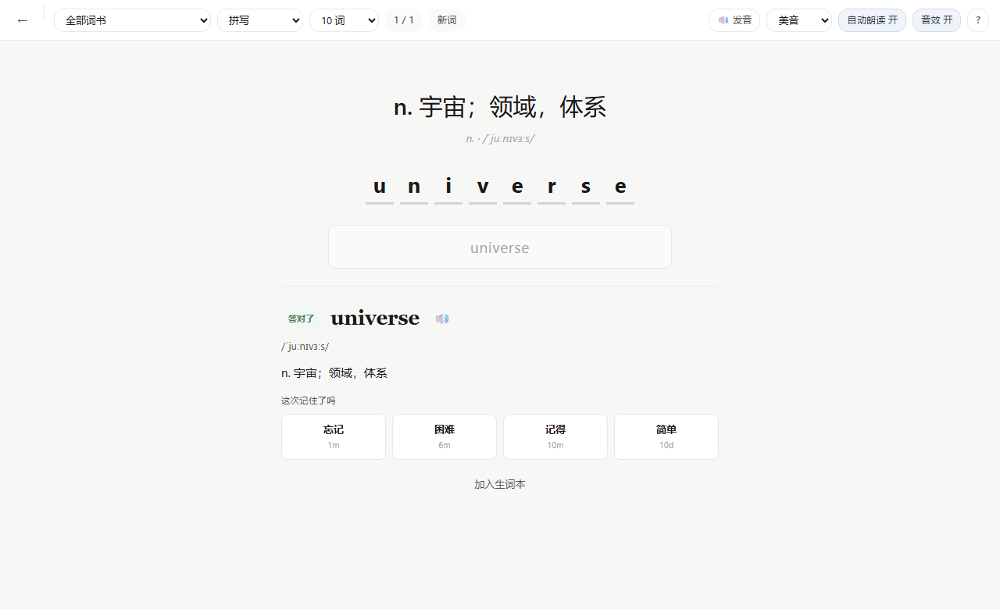
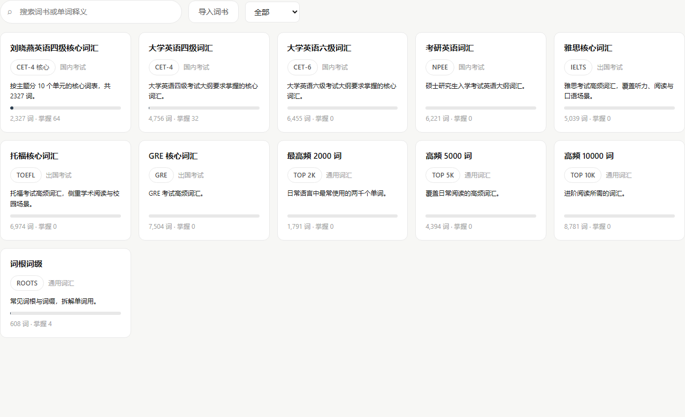

# LexiFlow

一个本地优先的英语词汇学习桌面应用。数据全部留在本机，用 **FSRS** 科学记忆算法
安排复习，用 **词根词缀** 帮你拆解生词。

**[下载最新版](https://github.com/ChenRy-1019/lexiflow/releases/latest)** ·
[安装说明](docs/INSTALL.md) · [数据来源](docs/DATA_SOURCES.md)

> Windows 10 / 11 64 位。双击安装，无需注册账号。

## 为什么做这个

现有的背单词软件大多在两个方向上走极端：要么塞满花哨的功能，要么只是一张
单词卡列表。LexiFlow 想解决的问题很具体——

**记忆该在什么时候发生，由算法决定，而不是由我决定。**

固定间隔的阶梯（1 天 → 2 天 → 4 天 → 7 天 → 15 天 → 30 天）把「abandon」和
「ubiquitous」当成同一类词，结果是前者被拖到该忘的时候才复习，后者被反复打扰。
FSRS 为每个词单独维护**记忆稳定度**（stability）和**难度**（difficulty），按目标
留存率反推下次复习时间：记得牢的词自动拉长间隔，记不牢的词很快回来。

## 功能

- **三种练习模式** — 拼写（看中文写英文）、词义选择、听音拼写
- **真人发音** — 首次播放时联网下载录音并缓存，之后离线可用；支持美音/英音切换
- **FSRS 调度** — 四个评分按钮（忘记 / 困难 / 记得 / 简单），每个按钮实时显示
  下次复习间隔，例如「3d」「2.1mo」
- **记忆强度** — 每个词显示当前预计留存率，让你知道哪些词正在变模糊
- **逐字母判定** — 拼错时用最长公共子序列对齐，标出真正错的那一个字母
- **词根词缀** — 内置 611 条词根词缀，其中 5,394 个词条附带了拆解
- **词库浏览** — 按分类筛选、全库搜索、查看任意词书的全部词条
- **生词本** — 答错不会自动收录，只有主动点击才进入
- **断点续学** — 退出后可从上次的位置继续
- **沉浸式练习** — 进入学习后隐藏侧栏，只留单词
- **本地存储** — SQLite 单文件，学习记录不上传任何服务器

内置词库共 **52,523** 条，分布在 10 本词书：

| 词书 | 条数 | 词书 | 条数 |
| --- | ---: | --- | ---: |
| 大学英语四级词汇 | 4,756 | 雅思核心词汇 | 5,039 |
| 大学英语六级词汇 | 6,455 | 托福核心词汇 | 6,974 |
| 考研英语词汇 | 6,221 | GRE 核心词汇 | 7,504 |
| 最高频 2000 词 | 1,791 | 词根词缀 | 608 |
| 高频 5000 词 | 4,394 | 高频 10000 词 | 8,781 |

## 界面

今日计划


练习页：看释义写英文，答完后按记忆程度评分



词库浏览



## 技术栈

| 层 | 选型 | 说明 |
| --- | --- | --- |
| 桌面外壳 | [Tauri 2](https://tauri.app) | Rust 后端，安装包约 3 MB |
| 前端 | React 19 + TypeScript + Vite | 无 UI 框架，样式全部手写 CSS 变量 |
| 存储 | SQLite（`rusqlite`） | WAL 模式，单文件数据库 |
| 调度 | [ts-fsrs](https://github.com/open-spaced-repetition/ts-fsrs) | FSRS 官方 TypeScript 实现 |
| 数据 | [ECDICT](https://github.com/skywind3000/ECDICT) | MIT 许可的英汉词典数据集 |

调度算法放在前端而非后端，是有意的：算法只有一份实现，且可以脱离数据库直接
做单元测试。后端只负责持久化。

## 快速开始（开发）

环境要求：Node.js 20+、Rust 1.77+，Windows 上还需要
[Visual Studio Build Tools](https://visualstudio.microsoft.com/downloads/#build-tools-for-visual-studio-2022)
（勾选「使用 C++ 的桌面开发」）。

```bash
npm install
npm run lexicon:build   # 下载 ECDICT 并生成词库（约 65 MB，只需一次）
npm run tauri:dev       # 开发模式，前端热重载
```

打包与分发：

```bash
npm run tauri:build     # 生成安装包
npm run package         # 生成可直接发给别人的 zip（约 3 MB）
```

## 项目结构

```
src/
  lib/
    fsrs.ts          FSRS 封装：评分、间隔预览、留存率估算
    speech.ts        发音：录音缓存、系统语音回退、并发控制
    week.ts          周表日期标签
    api.ts           与 Rust 后端的 IPC 桥接
    types.ts         领域类型定义
  pages/             今日计划、练习、词库、生词本、统计、设置
  components/        标题栏、开始学习对话框
  styles/global.css  设计令牌与全部样式

src-tauri/src/
  lib.rs       Tauri 命令
  session.rs   会话选择、进度统计、断点续学（纯逻辑，可单测）
  db.rs        SQLite 存储层
  lexicon.rs   词库加载与查询
  audio.rs     发音录音缓存
  util.rs      日期、文本归一化
  error.rs     错误类型

scripts/
  build-lexicon.ts      词库生成
  package.ps1           生成分发包
  audit-classes.mjs     检查组件用到的 CSS 类是否都有定义
```

## 测试

```bash
npm test                        # 前端：FSRS、发音调度、周表、IPC 契约、页面渲染
cd src-tauri && cargo test      # 后端：存储、词库、复习流程、断点续学
npm run audit:css               # 组件类名与样式表一致性
python scripts/check-backend.py # 词库完整性
```

前端测试里有一项会直接读取 `src-tauri/src/lib.rs`，比对 `#[tauri::command]`
函数与 `generate_handler!` 注册表是否一致，也检查前端调用到的每个命令名都
真实存在。两边不同步时测试会失败，而不是让程序在运行时崩溃。

另有真实 DOM 挂载测试，会渲染练习页并检查它确实产出内容——曾经的 hook
顺序错误会让整个页面空白，而类型检查发现不了。

## 许可

代码采用 [MIT 许可](LICENSE)。

词库数据来自 ECDICT（MIT 许可），详见 [数据来源与许可说明](docs/DATA_SOURCES.md)。
